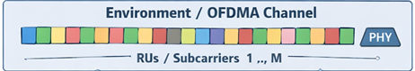
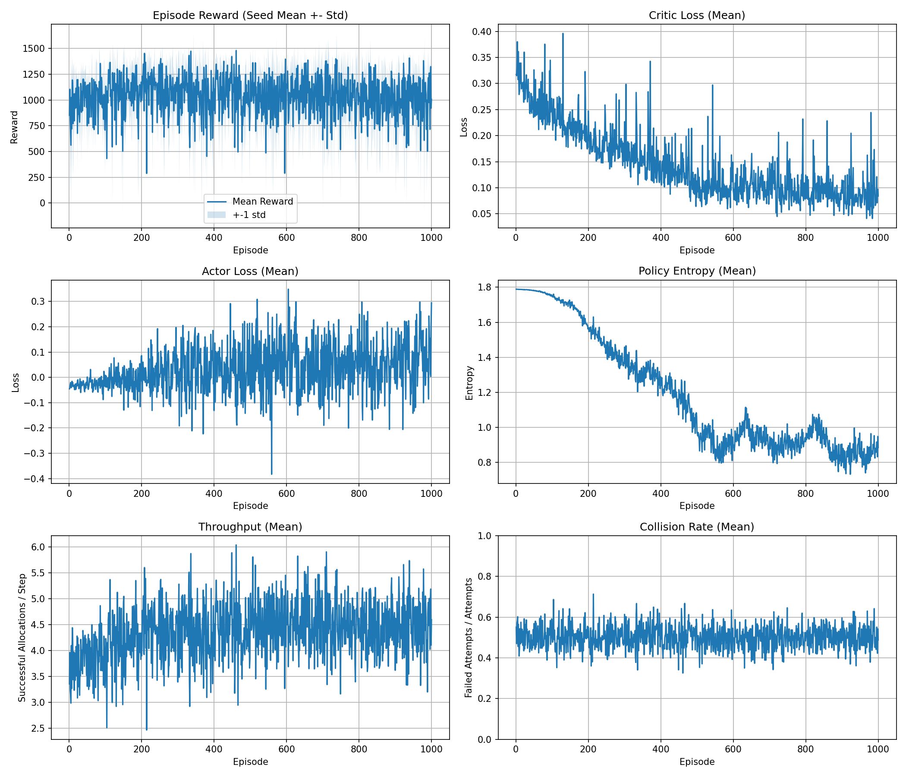

# OFDMA Actor-Critic Project Report

## Executive Summary
This report presents a consolidated and organized view of the OFDMA Actor-Critic project.

The policy learns RU-to-station allocation decisions in a stochastic environment. The main objective is to improve throughput and reward while controlling failures, queue pressure, and deadline pressure.

## Project Objective
Train an RL scheduler that decides, for each RU at each step, whether to allocate and to which station.

Target behavior:
- maintain strong throughput
- keep collision/failure rate under control
- avoid excessive queue growth
- avoid deadline pressure accumulation

## Environment Definition
Environment state and transitions are defined in the OFDMA environment module.

Per-step sequence:
1. Sample one action per RU from the actor policy.
2. Attempt allocations.
3. Resolve success/failure stochastically from RU quality (`RUqi`).
4. Update station queues and deadlines.
5. Compute reward and metrics.

Episode termination:
- episode ends when step count reaches the configured horizon.

## State and Space Definitions

### State Vector
The global state is a flattened vector composed of:
- RU features: `[allocation_status, RUqi]` for each RU
- normalized station queue features
- normalized station deadline features
- station success-share features
- global features: mean queue pressure, mean deadline pressure, normalized step index

Default state dimension: `36`.

### Observation Space
- continuous vector
- represented as a NumPy array used directly by actor and critic

### Action Space
Per RU action is categorical:
- `0`: no allocation
- `1..n_stations`: allocate RU to station `(action - 1)`

Full action per step: one integer action for each RU.

## Model Architecture

### Actor
- input: global state vector
- output: per-RU action logits
- role: sample allocation decisions

### Critic
- input: global state vector
- output: scalar state value
- role: support advantage estimation

### Optimization Flow
1. collect rollout trajectories
2. compute returns and advantages (GAE)
3. update critic
4. update actor with entropy regularization
5. log metrics

## Reward and Metrics

### Reward Terms
Reward includes:
- successful allocation gain
- attempt cost
- failure penalty
- queue penalty
- fairness penalty
- deadline-pressure penalty

### Logged Metrics
- episode reward
- critic loss
- actor loss
- policy entropy
- max action share
- throughput
- collision rate

Definitions:
- Throughput = successful allocations per step.
- Collision rate = failed attempts / attempted allocations.

## Visual Results

### Environment Visualization


### Training Curves


## Result Interpretation

### Healthy Signals
- reward trend improves with acceptable volatility
- critic loss stabilizes without persistent spikes
- entropy decreases gradually (confidence growth)
- throughput increases while collision rate remains stable or decreases

### Core Trade-off
- aggressive policy: higher throughput but potentially higher failure rate
- conservative policy: lower failure rate but potentially lower throughput

Good operating region:
- throughput gains without proportional increase in collision rate

### Practical Improvement Steps
1. Increase failure penalty slightly to reduce risky attempts.
2. Tune entropy decay to keep useful exploration longer.
3. Select checkpoints using reward + throughput + collision stability together.

## Reproducibility

### Run Multi-seed Training
```bash
cd code-v2
python run_3seed_test.py --episodes 1000 --output train.png
```

### Save Checkpoints
```bash
cd code-v2
python save_trained_models.py --episodes 1000 --seeds 42 43 44 --out-dir saved_models
```

## Key Files
- code-v2/ofdma_channel.py
- code-v2/odfma_environment_definition.py
- code-v2/actor_critic_definition.py
- code-v2/trajectory_definition.py
- code-v2/actor_critic_algorithm.py
- code-v2/run_3seed_test.py
- code-v2/save_trained_models.py
